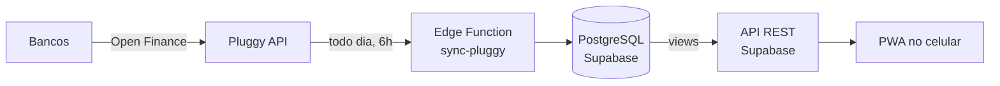

# Finance

App pessoal de finanças que fecha o orçamento **mês a mês**: puxa as compras dos cartões pelo Open Finance, separa o que é de cada pessoa, prevê parcelas e contas fixas e mostra quanto sobra.

> Projeto real, usado no dia a dia. Nasceu de uma planilha preenchida à mão e evoluiu para um app com banco de dados próprio.

## O problema

Todos os gastos passam pelo cartão de crédito, mas parte deles é de outras pessoas (família, namorada, um pequeno negócio), que devolvem o valor depois. A planilha manual exigia:

- digitar toda compra, toda semana;
- conferir cada fatura no fim do mês;
- calcular quanto cada pessoa devia;
- lembrar parcelas e contas que ainda iam cair.

## A solução

| Antes | Agora |
|---|---|
| Digitar compras | Sincronização diária via Open Finance (Pluggy) |
| Conferir fatura linha a linha | Conferência automática: soma das compras × total do banco |
| Calcular acertos na mão | Rateio por pessoa (valor fixo ou %) e acertos por mês |
| Lembrar parcelas | Parcelas futuras previstas e substituídas pela real quando chega |

## Arquitetura



- **Banco:** PostgreSQL (Supabase), com RLS em todas as tabelas.
- **Regras de negócio:** em SQL (views) e TypeScript (Edge Functions).
- **App:** PWA instalável, tema escuro.
- **Custo:** R$ 0 (planos gratuitos).

## Estrutura

```
docs/                  regras de negócio, modelo de dados e decisões
supabase/migrations/   evolução do banco, versionada
supabase/functions/    sincronização com a Pluggy
supabase/seed.sql      dados fictícios para testes
app/                   PWA
legacy/apps-script/    versão anterior, em Google Sheets + Apps Script
```

## Evolução

1. **Planilha manual:** uma aba por mês, tudo digitado.
2. **Google Sheets + Apps Script:** sincronização com a Pluggy, regras de categoria, previsão de parcelas e conferência de faturas. Validado contra 3 meses de dados reais (diferença de centavos, todas explicadas).
3. **Supabase + PWA** *(em andamento)*: banco relacional, app rápido no celular.

## Roadmap

- [x] Regras de negócio definidas e validadas
- [x] Modelo de dados
- [ ] Migração dos dados
- [ ] Sincronização como Edge Function
- [ ] PWA
- [ ] Cobrança pelo WhatsApp com Pix copia e cola

## Rodando localmente

Requer [Supabase CLI](https://supabase.com/docs/guides/cli) e Docker.

```bash
supabase start      # sobe Postgres local
supabase db reset   # aplica migrations + seed.sql (dados fictícios)
```

## Privacidade

Nenhum dado financeiro real, chave de API ou senha está neste repositório. Segredos ficam em `.env` (fora do Git) e dados pessoais em `supabase/local/` (também fora do Git).
