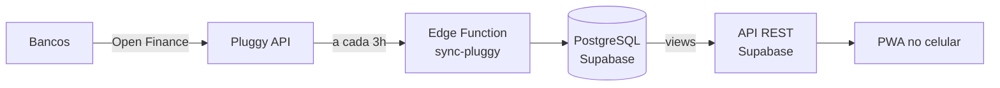

# Finance

App pessoal de finanças que fecha o orçamento **mês a mês**: puxa as compras dos cartões pelo Open Finance, separa o que é de cada pessoa, prevê parcelas e contas fixas e mostra quanto sobra.

> Projeto real, usado no dia a dia. Nasceu de uma planilha preenchida à mão e evoluiu para um app com banco de dados próprio.

## O problema

Todos os gastos passam pelo cartão de crédito, mas parte deles é de outras pessoas (família, namorada, um pequeno negócio), que devolvem o valor depois. A planilha manual exigia:

- digitar toda compra, toda semana;
- conferir cada fatura no fim do mês;
- calcular quanto cada pessoa devia;
- lembrar parcelas e contas que ainda iam cair.

## A solução

| Antes | Agora |
|---|---|
| Digitar compras | Sincronização diária via Open Finance (Pluggy) |
| Conferir fatura linha a linha | Conferência automática: soma das compras × total do banco |
| Calcular acertos na mão | Rateio por pessoa (valor fixo ou %) e acertos por mês |
| Lembrar parcelas | Parcelas futuras previstas e substituídas pela real quando chega |
| Saber se ainda posso gastar | Orçamento com limite por categoria: o que passa numa é descontado das outras, e o mês fecha na meta |

## Arquitetura



- **Banco:** PostgreSQL (Supabase), com RLS em todas as tabelas.
- **Regras de negócio:** em SQL (views e funções) e TypeScript (Edge Functions).
- **App:** React + TypeScript + Vite, TanStack Query (cache), tema escuro.
- **Custo:** R$ 0 (planos gratuitos).

## O app

Cinco abas, cada uma responde uma pergunta:

| Aba | Pergunta |
|---|---|
| **Mês** | Quanto ainda posso gastar? **Pode gastar** (já guardando a meta), quanto resta em cada categoria (Mercado, Comer fora, Lazer, Compras, Transporte e a reserva de Saúde + Imprevistos), fatura por cartão com conferência, a receber e parcelamentos com o teto |
| **Transações** | Pra onde foi? Tudo do mês agrupado, com o filtro **Pendentes** pra classificar compras novas (de quem é + categoria) |
| **Lançar** | Renda, débito (com divisão e parcelas) e gasolina |
| **Acertos** | Quem me deve: itens por pessoa, cobrança pelo WhatsApp e "Recebi" |
| **Mais** | Status dos bancos, telefones, contas fixas, limites do mês (renda base, reserva, meta, teto de parcelas), sair |

Um botão de olho esconde todos os valores.

## Estrutura

```
docs/                  regras de negócio, modelo de dados e decisões
supabase/migrations/   evolução do banco, versionada
supabase/functions/    sincronização com a Pluggy
supabase/seed.sql      dados fictícios para testes
app/                   PWA
legacy/apps-script/    versão anterior, em Google Sheets + Apps Script
```

## Evolução

1. **Planilha manual:** uma aba por mês, tudo digitado.
2. **Google Sheets + Apps Script:** sincronização com a Pluggy, regras de categoria, previsão de parcelas e conferência de faturas. Validado contra 3 meses de dados reais (diferença de centavos, todas explicadas).
3. **Supabase + app React**: banco relacional com as regras em SQL, app rápido no celular. Em uso desde outubro de 2026.

## Roadmap

- [x] Regras de negócio definidas e validadas
- [x] Modelo de dados
- [x] Migração dos dados
- [x] Sincronização como Edge Function (a cada 3h, via pg_cron)
- [x] App: Mês, Transações (com classificação), Lançar, Acertos e Mais
- [x] Cobrança pelo WhatsApp (link `wa.me` com a mensagem pronta)
- [x] Conferência de faturas e aviso de divergência
- [x] PWA instalável e deploy (Vercel)
- [x] Orçamento: limites em reais por categoria, reserva, meta e teto de parcelas

**Próxima fase**

- [ ] Pix copia e cola na mensagem de cobrança
- [ ] Mais de uma pessoa usando, com um banco por pessoa (*database-per-tenant*): a parte de cada uma nas compras do cartão de outra chega sozinha no app dela, já com a categoria
- [ ] Criar o banco de uma pessoa nova automaticamente (provisionamento)
- [ ] Notificações (a definir quais)
- [ ] Baixa automática de pagamentos pela conta corrente (a avaliar)

## Rodando localmente

Requer [Supabase CLI](https://supabase.com/docs/guides/cli) e Docker.

```bash
supabase start      # sobe Postgres local
supabase db reset   # aplica migrations + seed.sql (dados fictícios)

cd app && cp .env.example .env && npm install && npm run dev
```

## Privacidade

Nenhum dado financeiro real, chave de API ou senha está neste repositório. Segredos ficam em `.env` (fora do Git) e dados pessoais em `supabase/local/` (também fora do Git).
