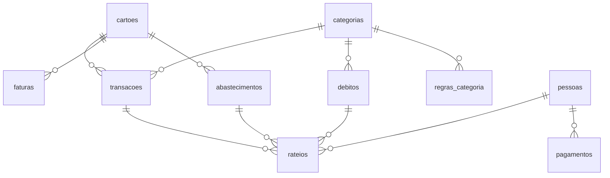

# Modelo de dados

PostgreSQL (Supabase). Todo "mês do orçamento" é guardado como o 1º dia do mês (`date`).

## Diagrama

## Tabelas

**Cadastros**

| Tabela | Para quê |
|---|---|
| `pessoas` | Quem divide gastos (o dono do app é implícito) |
| `categorias` | Categorias de gasto |
| `cartoes` | Cartões conectados ou não, com regras de fechamento e vencimento |
| `regras_categoria` | Texto da descrição → categoria (e divisão padrão opcional) |
| `contas_fixas` | Contas recorrentes com vigência |

**Movimento**

| Tabela | Origem |
|---|---|
| `transacoes` | Pluggy (cartões) |
| `faturas` | Pluggy |
| `conexoes` | Pluggy (status de cada banco) |
| `renda` | Manual |
| `debitos` | Manual (avulso ou parcelado) |
| `abastecimentos` | Manual (cartões não conectados) |
| `pagamentos` | Manual (acertos recebidos) |
| `rateios` | Parte de cada pessoa em uma transação, débito ou abastecimento |

## Decisões de modelagem

- **Rateios em tabela própria.** Em vez de um texto como `"Mãe 100; Eu 30,26"`, cada parte é uma linha (valor fixo **ou** percentual). O que não está em rateio é do dono. Isso torna os acertos uma simples soma.
- **Previsões não são gravadas.** Parcelas futuras e contas fixas previstas são geradas pelas views a cada consulta, então nunca ficam desatualizadas.
- **IDs da Pluggy como chave** em `transacoes` e `faturas`, o que torna a sincronização idempotente (upsert).
- **Competência gravada na transação**, recalculada a cada sincronização a partir da fatura (ou do dia de fechamento, se a fatura ainda não fechou).

## Views (próxima migration)

| View | Conteúdo |
|---|---|
| `v_lancamentos` | Tudo junto, com mês, tipo, valor, parte do dono e status (real, previsto, esperado, manual) |
| `v_mes` | Renda, saídas por grupo e sobra de cada mês |
| `v_acertos` | Devido e pago por pessoa e mês |
